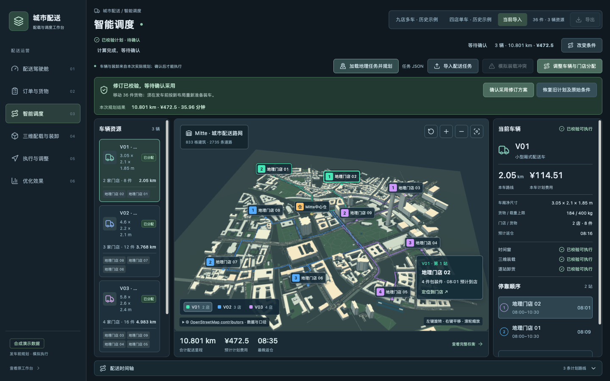
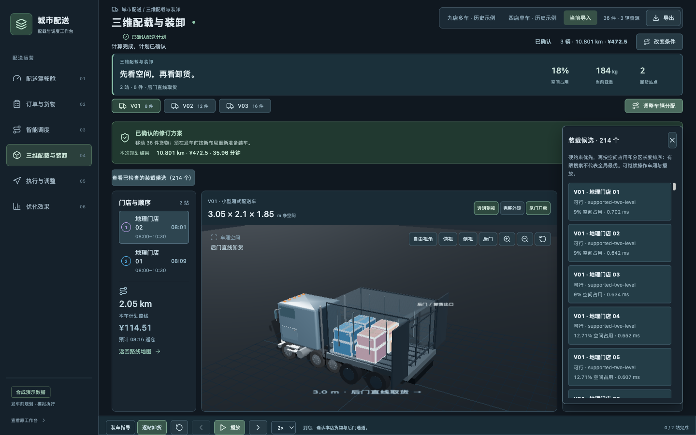
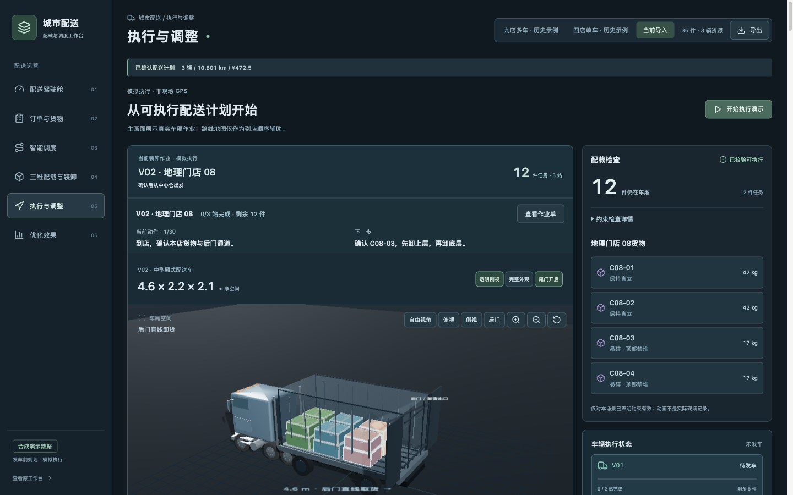
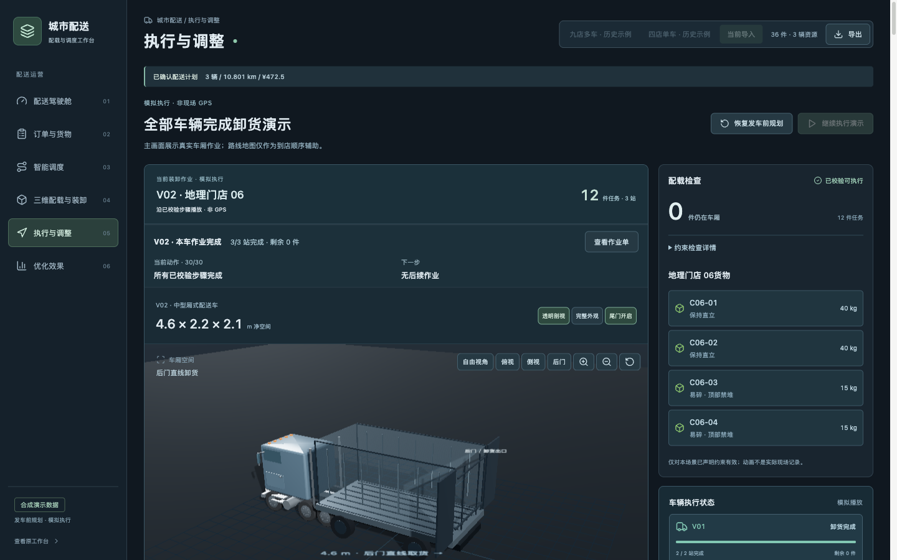
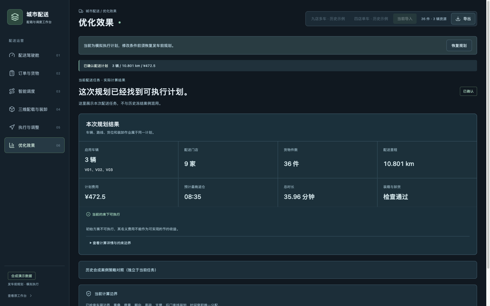

# 城市配送智能配载与运输调度优化系统

这是一个面向城市配送的可运行演示系统。它处理中心仓向多家门店配送不同包装件时的车辆分配、路线顺序、车厢空间、重量、时间窗和后门卸货可达性，并将计算结果转为可确认、可播放的配送计划。

路线不能只看距离，装载也不能只看“放得下”。如果当前路线导致目标门店货物无法从后门取出，装载检查会把失败原因反馈给路线和车辆分配；重新规划后，系统再次检查路线、货位、装车路径和逐站卸货，只有通过已声明约束并经用户确认的方案才能进入模拟执行。

## 三项核心能力

### 智能运力匹配与路线优化

使用门店、包装件、车辆、车厢、载重、时间窗、距离矩阵和费用参数，通过现有 OR-Tools 路线规划与联合反馈流程生成候选方案，展示车辆分配、访问顺序、到店/返仓时间、里程、费用及条件变化后的重新计算。

### 多约束三维智能装载

使用同一配送计划中的车辆和包装件数据生成三维货位，检查车厢边界、空间重叠、载重、朝向、易碎、支撑、承重和后门直线取货。04 页面展示真实计算返回的尺寸、坐标、朝向、门店归属和检查状态，并可查看有限范围内的候选布局。

### 智能装卸可视化与作业指导

05 页面使用后端返回的 loadingSteps 和 unloading.steps，展示当前车辆、当前门店、当前货物、下一步动作、站点进度、剩余货物、阻挡原因和作业单。支持暂停、继续、换车、完成播放及已确认计划导出。播放是已校验步骤的演示，不是真实 GPS、现场遥测或设备控制。

## 路线、装载与卸货的联合反馈

```text
订单与包装件 → 车辆与路线候选 → 三维货位 → 空间/重量/时间窗/卸货检查
          → 失败原因反馈到布局、车辆或路线 → 重新检查 → 用户确认
          → 装车与逐站卸货作业指导
```

技术贡献在于把装载与卸货检查得到的可用车辆资格、门店分区长度反馈到路线计算，减少只按名义路由费用选择却无法装卸的计划；3D 城市用于解释结果，不作为算法创新证据。每个最终候选仍需完整复核。目前找到首个可执行方案后即可停止，候选按费用、最长任务时间和车队空间利用率择优，不能据此宣称充分搜索或全局最优。

系统不会把距离更短的不可执行方案称为更优，也不会把有限搜索失败说成数学意义上的全局无解。

## 浏览器入口

- [配送驾驶舱](http://127.0.0.1:8111/frontend/city-delivery/overview)
- [订单与货物](http://127.0.0.1:8111/frontend/city-delivery/orders)
- [智能调度](http://127.0.0.1:8111/frontend/city-delivery/dispatch)
- [三维配载与装卸](http://127.0.0.1:8111/frontend/city-delivery/packing)
- [执行与调整](http://127.0.0.1:8111/frontend/city-delivery/execution)
- [优化效果](http://127.0.0.1:8111/frontend/city-delivery/effects)

01 和 02 提供“加载示例任务并计算”入口，读取柏林合成配送任务并实际请求 8114。计算结果进入 03，可继续在 04 查看货位、在 06 查看结果；人工确认后才允许 05 模拟执行及计划导出。

## 关键运行画面

以下图片均为仓库已有的真实 Chromium 操作截图。

### 03 智能调度



### 04 三维配载



### 05 执行与调整





### 06 优化效果



失败状态：[05 失败任务](artifacts/phase8a-screening/1440-failed-execution.png)、[06 失败原因](artifacts/phase8a-screening/1440-failed-effects.png)、[完整 Phase 8A 证据](artifacts/phase8a-screening/README.md)。

## 项目结构

| 目录 | 内容 |
| --- | --- |
| [frontend/src/features/city-delivery/product/](frontend/src/features/city-delivery/product/) | 六个页面、状态管理、三维配载、作业指导和结果展示 |
| [frontend/src/features/city-delivery/](frontend/src/features/city-delivery/) | 场景数据适配、Three.js 车厢和地理场景 |
| [frontend/public/demo/city-delivery/v1/](frontend/public/demo/city-delivery/v1/) | 四店单车合成场景 |
| [frontend/public/demo/city-delivery/v2/](frontend/public/demo/city-delivery/v2/) | 九店多车历史合成场景 |
| [frontend/public/demo/city-delivery/geo-city/v1/](frontend/public/demo/city-delivery/geo-city/v1/) | 柏林离线 OSM 建筑、道路和任务数据 |
| [tools/city-delivery-decision/](tools/city-delivery-decision/) | 8114 规划服务、标准输入校验、路线/装载/卸货检查 |
| [tools/city-delivery-geo/](tools/city-delivery-geo/) | 离线城市 GIS 构建与核验脚本 |
| [frontend/e2e/](frontend/e2e/) | 城市配送与 GIS 浏览器回归 |
| [artifacts/phase8a-screening/](artifacts/phase8a-screening/) | 初筛截图、请求结果和回归证据 |

仓库还保留其他历史 Solution Pack 和制造业履约项目代码。城市配送作品的页面、计算服务、数据和证据以上述目录为准；历史代码和历史数据没有被删除或改写。

## macOS / Linux 本地运行

需要 Node.js 24、Python 3.12 和 Chromium。

```bash
git clone https://github.com/yyy990045-sketch/fulfillment-exception-pack-v2.git
cd fulfillment-exception-pack-v2
npm ci
python3.12 -m venv tools/city-delivery-decision/.venv
tools/city-delivery-decision/.venv/bin/python -m pip install -r tools/city-delivery-decision/requirements.txt
npx playwright install chromium
```

启动后端：

```bash
PYTHONUTF8=1 tools/city-delivery-decision/.venv/bin/python tools/city-delivery-decision/server.py --port 8114
```

另开终端启动前端：

```bash
VITE_LOGISTICS_DIRECT=true npm run frontend:dev -- --host 127.0.0.1 --port 8111 --strictPort
```

打开 <http://127.0.0.1:8111/frontend/city-delivery/overview>。前后端均为本地演示服务，不需要地图密钥或在线地图服务；浏览器需要支持 WebGL。

## 已验证命令

```bash
npm run typecheck
npm run frontend:test
npm run frontend:build

tools/city-delivery-decision/.venv/bin/python tools/city-delivery-decision/verify.py
tools/city-delivery-decision/.venv/bin/python tools/city-delivery-decision/verify_v3.py --output-dir /tmp/city-delivery-evidence
tools/city-delivery-decision/.venv/bin/python tools/city-delivery-geo/verify_city_gis.py

CITY_DELIVERY_PYTHON="$PWD/tools/city-delivery-decision/.venv/bin/python" npx playwright test --config frontend/playwright.city-delivery.config.ts
CITY_DELIVERY_PYTHON="$PWD/tools/city-delivery-decision/.venv/bin/python" npx playwright test --config frontend/playwright.city-geo.config.ts
```

已有证据：[Phase 6 真实 3D 城市和同源路网](docs/competition/phase6-real-3d-gis.md)、[Phase 6 算法与 GIS 独立验收](docs/competition/phase6-algorithm-acceptance.md)、[Phase 7B 480 分钟路线时长修复](docs/competition/phase7b-max-route-duration.md)、[Phase 7B 边界与回归证据](docs/competition/phase7b-evidence/)、[Phase 8A 初筛截图和结果](artifacts/phase8a-screening/README.md)。

## 真实性与能力边界

- 订单、门店、车辆、费用和配送任务是合成演示数据，不是企业真实订单或经营收益。
- 建筑和道路来自离线 OSM 数据；建筑高度部分来自标签、楼层估算或默认估算，不代表实测高度。
- 路线依赖离线道路网络和声明的速度/距离模型，不包含实时交通、完整转向限制、限高限重、GPS 或司机工时。
- 装载搜索只覆盖声明的有限布局、支撑、朝向和后门直线卸货规则，不保证全局最优。
- 执行页面是基于已校验作业步骤的模拟播放，不是真实现场执行记录。
- 当前不支持任意在途重装、额外搬运、轴荷重心、绑扎、冷链和生产系统接入。
- 不把历史预计算方案切换描述为实时重新优化；历史九店的 50 km / ¥592 与 38 km / ¥450.4 保留其历史来源，并与标准接口的新任务结果分开。

两组浏览器检查应依次运行，避免同时写入默认测试输出目录。Linux 若缺少浏览器系统依赖，可使用 Playwright 的安装提示补齐。建议 Python 3.12；原 macOS 机器也已在 Python 3.9.6 / OR-Tools 9.11.4210 下完成运行验证。首次安装依赖需要联网，示例运行不依赖外部 AI API。

本次比赛提交此 GitHub 仓库链接。仓库为私有，评委须获得访问权限；克隆时需使用已获授权的 GitHub 账号。这里的 localhost 链接只用于安装后的本地访问，不是在线部署地址。
